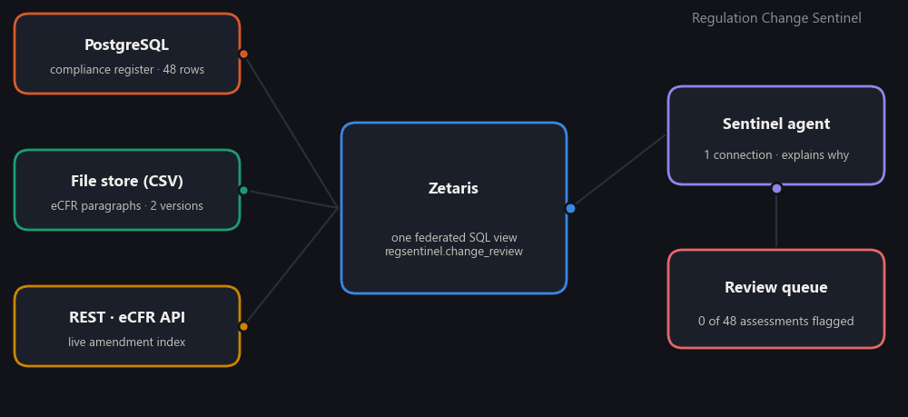
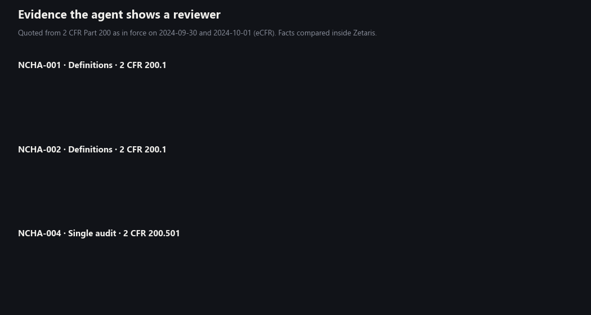
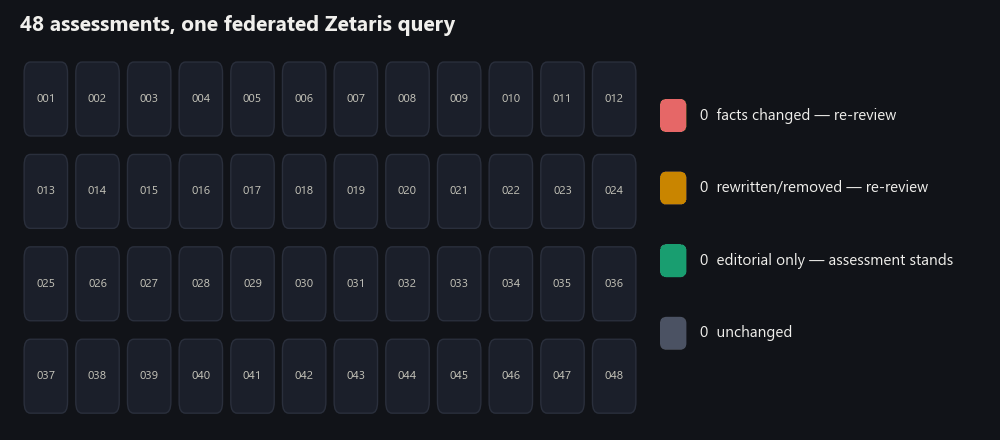
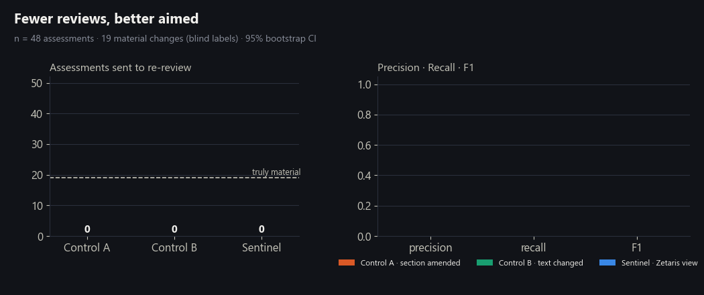
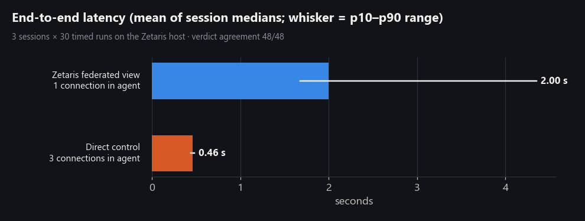
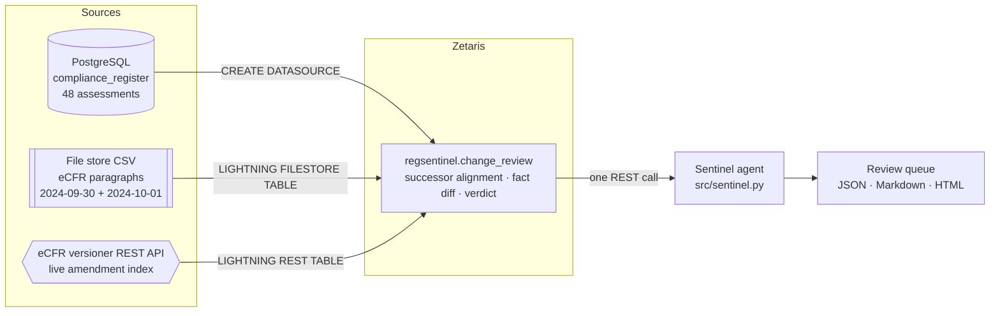

<div align="center">

# Regulation Change Sentinel

**When the rules behind your grants change overnight, which compliance decisions are now wrong?**

An explainable agent that re-checks a grant recipient's compliance register against a rewritten federal regulation, using **one federated [Zetaris](https://www.zetaris.com) view** over a PostgreSQL database, a file store and the **live eCFR government API**.

[](https://github.com/Agnuxo1/zetaris-regulation-change-sentinel/actions/workflows/ci.yml)




</div>

---

## Contents

- [The problem](#the-problem)
- [What the Sentinel does](#what-the-sentinel-does)
- [Zetaris, live](#zetaris-live)
- [Results](#results)
- [How it works](#how-it-works)
- [Reproduce it](#reproduce-it)
- [Repository layout](#repository-layout)
- [Exact role of Zetaris](#exact-role-of-zetaris)
- [Limitations and honest notes](#limitations-and-honest-notes)
- [Credits and licences](#credits-and-licences)

## The problem

On **1 October 2024** the U.S. Uniform Guidance for federal awards, **2 CFR Part 200**, was rewritten. The official eCFR version index marks **188 sections** as amended on that date. Thresholds every grants office relies on moved — equipment from $5,000 to $10,000, the single-audit trigger from $750,000 to $1,000,000, the MTDC subaward cap from $25,000 to $50,000 — while hundreds of other paragraphs changed only in wording ("non-Federal entity" became "recipient or subrecipient").

A grants office holds dozens of documented compliance assessments, each quoting the paragraph it relied on. After a rewrite like this, the safe default is to re-review all of them. That is expensive, and most of the work is wasted on editorial changes.

## What the Sentinel does

For every assessment in the register, the Sentinel answers three questions and shows its evidence:

1. **Is the quoted paragraph still there, word for word?** → `UNCHANGED`
2. **If not, where is its successor in the new version?** The closest paragraph of the same section by normalised Levenshtein distance; nothing close enough → `REVIEW_NOT_FOUND`.
3. **Did the facts change?** Amounts, percentages, durations and obligation words (`must`, `may`, `unallowable`, `prior approval`, …) are extracted from both versions and compared. Any difference → `REVIEW_MATERIAL`; none → `EDITORIAL_ONLY` and the assessment stands.

All three decisions run **inside Zetaris**, as a single SQL view that joins the three live sources. The agent only reads that view and turns each row into an explanation a reviewer can check in seconds:





## Zetaris, live

A continuous browser capture (sped up ×1.6) of the Zetaris SQL Workspace running on our own server, recorded on 28 October 2026. One statement counts rows from all three sources at once — **48** assessments from PostgreSQL, **1,289** regulation paragraphs from the file store and **878** version records straight from the eCFR API — then the federated view produces the verdict summary and the review queue.


The full demo video (3 min 47 s, English narration and subtitles) is attached to the [latest release](https://github.com/Agnuxo1/zetaris-regulation-change-sentinel/releases/latest).

## Results

### Detection quality — 48 assessments, blind labels

Ground truth comes from an **independent annotator who never saw the detection method**: for each assessment it read the cited 2024-09-30 paragraph and the 2024-10-01 text and decided whether the requirement changed in substance (19 material, 26 editorial, 3 byte-identical). The decision rule and its one threshold (successor distance ≤ 0.60) were fixed **before** the labels existed and were not tuned on them.

| Method | Sent to re-review | Precision | Recall | F1 | F1 95% CI (bootstrap, 3 seeds) |
|---|---:|---:|---:|---:|---|
| Control A — re-review every section the eCFR marks as amended | 48 | 0.40 | 1.00 | 0.57 | 0.41 – 0.70 |
| Control B — re-review whenever the cited text is not identical | 45 | 0.42 | 1.00 | 0.59 | 0.44 – 0.72 |
| **Sentinel — federated Zetaris view** | **25** | **0.64** | **0.84** | **0.73** | **0.55 – 0.86** |



- The Sentinel **halves the review load** (25 instead of 48) and finds **16 of the 19** material changes.
- Robustness: on the 40 randomly sampled assessments only (excluding 8 hand-picked anchors) F1 is 0.62 vs 0.46 / 0.49; on the 32 high-confidence labels it is 0.80 vs 0.48 / 0.51.
- Its three misses are wording-only shifts in obligation (`will` → `should`, a narrowed approver, a widened scope); its nine false alarms are mostly restatements such as "unallowable except with approval" → "allowable only with approval". Every error is listed in [`eval/results.json`](eval/results.json).

### Correctness and latency — Zetaris view vs. a direct control

The same rule was re-implemented in plain Python (`src/control_direct.py`), connecting to PostgreSQL, reading the CSV and calling the eCFR API itself. Both paths ran in a container on the Zetaris host network: 3 sessions × 30 timed runs after 3 warm-ups.

| | Zetaris federated view | Direct control (no Zetaris) |
|---|---:|---:|
| Verdict agreement | **48 / 48** in all 3 sessions | — |
| Median end-to-end latency per session | 1.79 s · 2.36 s · 1.85 s | 0.46 s · 0.46 s · 0.46 s |
| Connections the agent must hold | **1** | 3 |
| Client libraries in the agent | **Python stdlib only** | psycopg, csv, urllib, rapidfuzz |



Zetaris is **slower** here — about 1.5 s more per run on a 48-row register — and we report it as such. For a job that runs when a regulation changes, that cost buys a single governed endpoint, no per-source client code in the agent, and a rule that any SQL user can audit.

Raw numbers: [`bench/results/`](bench/results) · [`eval/metrics.csv`](eval/metrics.csv) · [`experiments/LOG.md`](experiments/LOG.md).

## How it works



The heart of the project is [`sql/20_change_review_view.sql`](sql/20_change_review_view.sql). In outline:

```sql
WITH reg   AS (SELECT ... FROM grants_pg.compliance_register),                 -- PostgreSQL
     newp  AS (SELECT ... FROM ecfr_files.paragraphs WHERE version_date = '2024-10-01'),  -- file store
     amend AS (SELECT cv.identifier, max(cv.amendment_date) ...
               FROM ecfr_rest.part200_versions LATERAL VIEW explode(content_versions) t AS cv ...), -- live REST
     cand  AS (SELECT ..., levenshtein(lower(r.cited_text), lower(n.paragraph_text))
                          / greatest(length(r.cited_text), length(n.paragraph_text)) AS distance ...),
     best  AS (... row_number() OVER (PARTITION BY assessment_id ORDER BY distance) = 1),
     facts AS (... regexp_extract_all(...) ...)
SELECT ..., array_except(facts_before, facts_after) AS facts_removed,
            array_except(facts_after, facts_before) AS facts_added,
            CASE WHEN distance = 0 THEN 'UNCHANGED' ... END AS verdict
```

## Reproduce it

Requirements: a running Zetaris instance (the free local Docker install from the [Zetaris getting-started guide](https://zetaris.github.io/getting-started) works), Python ≥ 3.10 and Docker for the demo PostgreSQL.

```bash
git clone https://github.com/Agnuxo1/zetaris-regulation-change-sentinel
cd zetaris-regulation-change-sentinel
pip install -r requirements.txt

# 1. Data (already committed; re-fetch to verify)
python scripts/fetch_ecfr.py          # official eCFR text for 26 sections, two versions
python scripts/build_register.py      # fictional register, seeded sample (seed 20261028)

# 2. Sources next to Zetaris (Docker network of your Zetaris install)
docker run -d --name regsentinel-pg --network <zetaris_network> \
  -e POSTGRES_DB=grants -e POSTGRES_USER=registrar -e POSTGRES_HOST_AUTH_METHOD=trust \
  -v "$PWD/sql/00_postgres_register_init.sql:/docker-entrypoint-initdb.d/init.sql:ro" postgres:16-alpine
docker cp data/processed/paragraphs.csv <zetaris_driver>:/home/zetaris/customer-data/shared/regsentinel/paragraphs.csv

# 3. Register sources + create the view, then run the agent
cp .env.example .env                  # fill in your Zetaris URL and credentials (never commit it)
export ZETARIS_ENV_FILE=.env
python -m src.sentinel provision
python -m src.sentinel review         # writes results/latest/review.{json,md,html}

# 4. Evaluate and benchmark
python eval/evaluate.py
bash bench/run_on_server.sh           # on the Zetaris host; 30 timed runs per path
python scripts/make_figures.py        # regenerates every figure in docs/assets
```

Offline checks (no Zetaris needed) run in CI: `pytest -q`.

## Repository layout

| Path | What it holds |
|---|---|
| `sql/` | Source registration (`10_…`), the federated decision view (`20_…`), demo queries (`30_…`), PostgreSQL seed (`00_…`) |
| `src/sentinel.py` | The agent: provisions Zetaris, runs the review, writes explanations |
| `src/zetaris_client.py` | 80-line REST client for the Zetaris SQL endpoint (stdlib only) |
| `src/control_direct.py` | Control pipeline without Zetaris (same rule, three direct connections) |
| `data/` | Raw eCFR XML, processed paragraphs, the fictional compliance register |
| `eval/` | Blind labelling packet, labels, evaluation script and metrics |
| `bench/` | Latency/agreement benchmark and its raw results |
| `results/latest/` | The review queue produced by the live run (JSON, Markdown, HTML) |
| `demo/` | Browser recording and video assembly scripts used for the challenge video |
| `evidence/` | Screenshots and event log of the live Zetaris recording |
| `experiments/` | Experiment log (hypothesis → control → result → decision) |

## Exact role of Zetaris

- **Federation layer (central, not a cameo).** All three sources are registered in Zetaris: a PostgreSQL `DATASOURCE`, a `LIGHTNING FILESTORE TABLE` over CSV and a `LIGHTNING REST TABLE` over the live eCFR API. The decisive query joins all three.
- **Decision engine.** The change-detection rule — successor alignment (`levenshtein`, window `row_number`), fact extraction (`regexp_extract_all`, `regexp_replace`) and set comparison (`array_except`) — is a Zetaris `SCHEMASTORE VIEW`. The agent contains no matching logic.
- **Single endpoint for the agent.** The agent authenticates once and issues one SQL call over REST; it never sees the PostgreSQL connection or the file path.
- **Verified against a control.** An independent Python implementation agrees on 48/48 verdicts, so the federated SQL is checked, not assumed.

## Limitations and honest notes

- **Data.** Regulatory text is the official eCFR (U.S. Government work, public domain). The organisation "NCHA", its owners and its 48 assessments are **fictional**; each assessment quotes a real paragraph. Nothing here is legal advice; a person makes every compliance decision.
- **Sample size.** 48 assessments and one annotator. Confidence intervals are wide (F1 0.55–0.86); the margin over the controls is clear on the point estimates and on both subsets, but this is a demonstration-scale evaluation.
- **Latency.** Zetaris adds ≈ 1.5 s per run versus direct access in our setup (one machine, small data). We did not test larger registers.
- **Live API.** The REST table reads the eCFR API at query time; results depend on its availability. The paragraph snapshots are fixed files so the evaluation is reproducible.
- **Coding agents.** The code was written with Claude Code (Anthropic). SpaceXAI's coding agents were **not** used in this build, and we do not claim that criterion.
- **Voice.** The demo video's narration, including the "why Zetaris was amazing" segment, is a synthetic voice (Microsoft neural TTS) reading the team's own statement.

## Credits and licences

- **Code:** MIT — see [LICENSE](LICENSE).
- **eCFR text** (`data/raw`, `data/processed/paragraphs.csv`): U.S. Government work, not subject to copyright in the United States; retrieved from the [eCFR versioner API](https://www.ecfr.gov/developers/documentation/api/v1).
- **Compliance register** (`data/processed/compliance_register.csv`): fictional, released under CC0 1.0.
- **Zetaris** Lightning platform (local Docker install) — © Zetaris; used under its participant terms for the Open Agent Hackathon 2026.
- Libraries: PostgreSQL, psycopg, RapidFuzz, matplotlib, Pillow, Playwright, FFmpeg.
- This repository is a new, standalone project built for the **Zetaris Demo Challenge**. It shares its theme (explainable evidence-change review) with our Open Agent Hackathon entry [Evidence Change Sentinel](https://github.com/Agnuxo1/evidence-change-sentinel), but reuses none of its code, H-MEM or Meterless Nightshift components.

**Author:** Francisco Angulo de Lafuente ([@Agnuxo1](https://github.com/Agnuxo1)) — team *Evidence Change Sentinel*.
